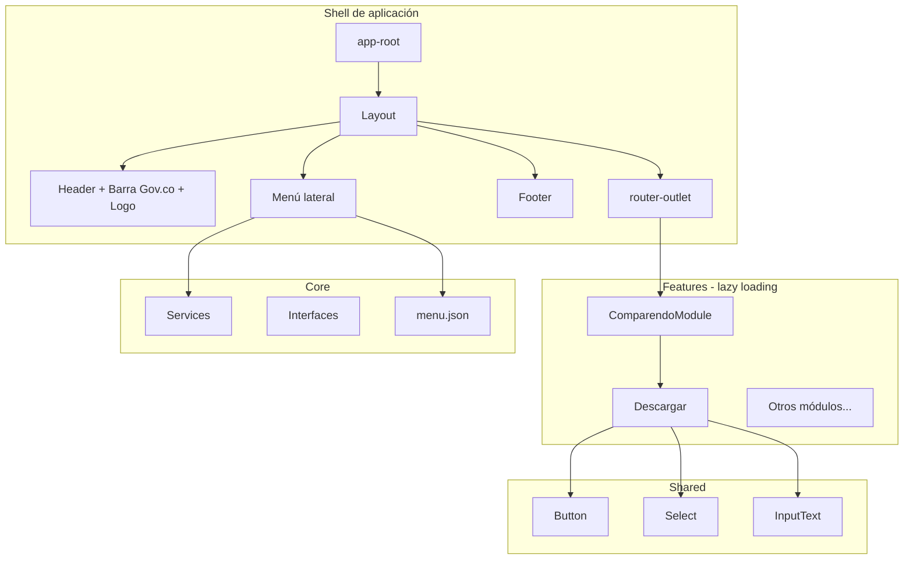

# SSJ Front

Frontend de **Gestión Acceso Justicia** para la Alcaldía de Santiago de Cali. Aplicación Angular 21 con diseño Gov.co / MinTIC, orientada a módulos funcionales (comparendos, medidas correctivas, pedagogía).

Generado con [Angular CLI](https://github.com/angular/angular-cli) 21.2.19.

## Stack tecnológico

| Tecnología | Uso |
|---|---|
| Angular 21 | Framework principal (standalone components) |
| Bootstrap 5 | Grid, acordeón, formularios |
| RxJS | Consumo de APIs |
| Vitest | Pruebas unitarias |
| Estilos Gov.co | `public/assets/css/all.css` (MinTIC) |

## Arquitectura

La aplicación sigue una **arquitectura por capas** con separación entre shell, dominio y componentes reutilizables.



### Capas

#### `src/app/core/`
Infraestructura transversal de la aplicación.

- **`header/`** — Cabecera institucional (barra Gov.co, logo Alcaldía, mega menú).
- **`footer/`** — Pie de página Gov.co resumido.
- **`menu/`** — Menú lateral en acordeón, generado desde `menu.json`.
- **`services/`** — Servicios HTTP (`TramiteService`, etc.).
- **`interfaces/`** — Tipos TypeScript compartidos.

#### `src/app/shared/components/`
Componentes UI reutilizables (standalone):

- `button` — Botón con `@Input label` y `@Output clicked`.
- `select` — Selector con opciones.
- `input-text` — Campo de texto con label.

#### `src/app/features/`
Módulos de negocio. Cada feature puede tener:

- Páginas (componentes standalone).
- `*-module.ts` — NgModule para lazy loading.
- `*-routing-module.ts` — Rutas hijas del módulo.

Módulos previstos en `menu.json`:

| Módulo | Ruta base | Estado |
|---|---|---|
| Comparendos Ley 1801 | `/gestion-acceso-justicia/comparendo` | Implementado (descargar) |
| Medida Correctiva Multa | `/gestion-acceso-justicia/medida-multa` | Pendiente |
| Medida Correctiva Pedagogía | `/gestion-acceso-justicia/pedagogia` | Pendiente |

#### `public/assets/`
Archivos estáticos servidos en `/assets/`:

- `css/all.css` — Estilos Gov.co / MinTIC.
- `images/` — Logos e imágenes institucionales.

#### `src/environments/`
Configuración por ambiente (`TYSA_API_URL`, etc.).

## Enrutamiento

```
/  →  Layout (shell)
      ├── Header
      ├── Menu (sidebar)
      ├── router-outlet  ← contenido dinámico
      └── Footer

/gestion-acceso-justicia/comparendo/descargar  →  Descargar (lazy)
/gestion-acceso-justicia/comparendo             →  redirect a descargar
```

- **`app.routes.ts`** — Ruta raíz con `Layout` y lazy loading de features.
- **`menu.json`** — Define la estructura del menú lateral y las URLs de navegación.
- El menú construye rutas como: `basePath + module.path + child.path`.

## Menú declarativo

El archivo `src/app/core/menu/menu.json` centraliza:

- Label del módulo padre (`Gestión Acceso Justicia`).
- `basePath` de navegación.
- Módulos hijos con sus páginas (`children`).

Al agregar una nueva pantalla:

1. Crear el componente en `features/<modulo>/`.
2. Registrar la ruta en `*-routing-module.ts`.
3. Agregar la entrada en `menu.json`.
4. Registrar lazy loading en `app.routes.ts` (si el módulo es nuevo).

## Patrón de componentes

- **Standalone** — Layout, header, footer, menu, páginas y shared components.
- **NgModule + lazy loading** — Features como `ComparendoModule` para cargar rutas bajo demanda.
- **Híbrido** — Los componentes standalone se referencian directamente en rutas hijas del NgModule.

## Estilos

| Origen | Alcance |
|---|---|
| `public/assets/css/all.css` | Gov.co global (vía `index.html`) |
| `bootstrap.min.css` | Utilidades y grid (`angular.json`) |
| `src/styles.css` | Overrides globales del proyecto |
| `*.css` por componente | Estilos encapsulados (header, footer, páginas) |

## Estructura de carpetas

```
ssj-front/
├── public/assets/          # Estáticos (/assets/...)
├── src/
│   ├── app/
│   │   ├── core/           # Shell, menú, servicios
│   │   ├── shared/         # Componentes reutilizables
│   │   ├── features/       # Módulos de negocio
│   │   ├── app.routes.ts
│   │   └── app.config.ts
│   ├── environments/
│   └── index.html
├── angular.json
└── package.json
```

## Comandos

### Servidor de desarrollo

```bash
npm start
# o: ng serve
```

Abrir `http://localhost:4200/`.

### Build

```bash
npm run build
```

Artefactos en `dist/ssj-front/`.

### Scaffolding

```bash
ng generate component features/<modulo>/<pagina>
```

### Tests

```bash
ng test
```

## Recursos

- [Angular CLI](https://angular.dev/tools/cli)
- [Documentación Angular 21](https://angular.dev)
